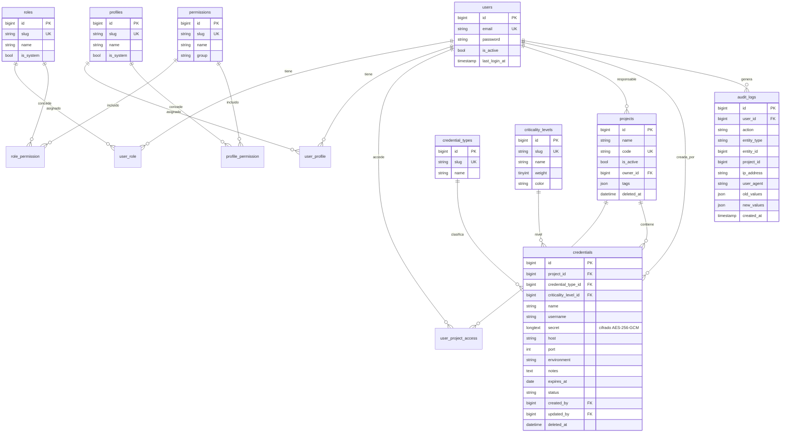

# Credential Vault — resguardo de credenciales por proyecto

Aplicación web para **resguardar, administrar y controlar el acceso a credenciales y datos sensibles por proyecto** (bases de datos, servidores, APIs, cloud, repositorios…). Un único proyecto **Laravel 12** con frontend **React + Inertia.js + Ant Design**, MySQL, RBAC granular, cifrado de secretos y auditoría completa.

## Contenido
[Arquitectura](#arquitectura) · [Stack](#stack-y-justificación-de-ant-design) · [Requisitos](#requisitos-previos) · [Instalación](#instalación-local) · [Estructura](#estructura-de-carpetas) · [Modelo de datos](#modelo-de-datos) · [RBAC](#roles-perfiles-permisos-y-acceso-por-proyecto) · [API](#api) · [Cifrado](#cifrado-de-secretos) · [Auditoría](#política-de-auditoría) · [Pruebas](#pruebas) · [Producción](#despliegue-en-producción) · [Seguridad](#recomendaciones-de-seguridad) · [Decisiones](#registro-de-decisiones-técnicas)

## Arquitectura

```
Navegador ── Inertia (páginas React) ──┐
   │  axios + cookie de sesión + CSRF  │
   ▼                                   ▼
 /api/*  ──► Middleware (auth, active, permission) ──► Controllers ──► Form Requests
                                                          │
                                              Policies/Gates (autorización fina)
                                                          ▼
                       Services (Credential, User, Role, Audit, Dashboard, SecretVault, LoginThrottle)
                                                          ▼
                                       Eloquent ─► MySQL   (secretos cifrados AES-256-GCM)
```

* Las **páginas** las sirve Inertia (`routes/web.php`); los **datos** se cargan desde la **API interna** (`routes/api.php`, prefijo `/api`, grupo `web` ⇒ sesión + CSRF).
* La autorización se aplica **siempre en el backend** (middleware `permission:*`, Policies, scopes `visibleTo`). El frontend solo oculta/deshabilita por UX.
* La lógica sensible vive en **servicios** (`app/Services`), no en controladores.

## Stack y justificación de Ant Design

PHP 8.2+, Laravel 12, MySQL 8, Inertia.js 2, **React 19 + Ant Design 6**, Vite, Recharts (gráficas), PHPUnit.

**¿React o Vue?** Se eligió **React + Ant Design React** porque: (1) `antd` es la implementación de referencia, con mayor cobertura de componentes (Table, Form, Modal, ConfigProvider) y localización `es_ES`; (2) `@inertiajs/react`, `laravel-vite-plugin` y `@vitejs/plugin-react` se integran en Laravel 12 sin configuración especial; (3) los errores de la API (`errors.campo`) se enlazan directamente con `Form.setFields`.

## Requisitos previos
PHP ≥ 8.2 (`mbstring`, `openssl`, `pdo_mysql`), Composer 2, Node ≥ 20 + npm, MySQL ≥ 8.0 (o MariaDB ≥ 10.6).

## Instalación local

```bash
git clone <repo> && cd inventario_credenciales
composer install
npm install
cp .env.example .env
php artisan key:generate
php artisan credentials:generate-key     # copia la línea VAULT_KEY=... en .env
```

### Base de datos MySQL
```sql
CREATE DATABASE credential_vault CHARACTER SET utf8mb4 COLLATE utf8mb4_unicode_ci;
CREATE USER 'vault'@'localhost' IDENTIFIED BY '<contraseña-fuerte>';
GRANT ALL PRIVILEGES ON credential_vault.* TO 'vault'@'localhost';
```

### Configuración `.env`
| Variable | Descripción |
|---|---|
| `DB_*` | Conexión MySQL (`DB_CONNECTION=mysql`, host, puerto, base, usuario, contraseña). |
| `VAULT_KEY` | Clave AES-256 de cifrado de secretos (`php artisan credentials:generate-key`). Vacía ⇒ se usa `APP_KEY`. **Defínela antes de guardar secretos y respáldala por separado.** |
| `VAULT_PREVIOUS_KEYS` | Claves anteriores (separadas por coma) para rotación. |
| `INSTALL_ADMIN_NAME/EMAIL/PASSWORD` | Opcionales: superadmin para instalación no interactiva. |
| `LOGIN_MAX_ATTEMPTS`, `LOGIN_BASE_LOCKOUT_SECONDS`, `LOGIN_MAX_LOCKOUT_SECONDS` | Bloqueo progresivo del login. |
| `SESSION_*` | Sesión en BD y cifrada; en producción `SESSION_SECURE_COOKIE=true`. |

### Migrar, sembrar e instalar
```bash
php artisan migrate                    # crea el esquema
php artisan db:seed                    # catálogos, permisos, roles y perfiles (idempotente, sin usuarios)
php artisan credentials:install        # orquesta todo lo anterior + crea el superadministrador
php artisan credentials:install --with-demo-data   # además: 3 proyectos, 15 credenciales ficticias y 3 usuarios demo
```

`credentials:install` verifica la conexión MySQL, migra, siembra y crea el **primer superadministrador**: pide correo/nombre/contraseña; si no das contraseña genera una aleatoria que se muestra **una sola vez** (también acepta `--name --email --password` o `INSTALL_ADMIN_*`). Termina con un resumen de lo creado. Es **idempotente**: si ya hay un superadmin activo no crea otro. Los usuarios demo reciben contraseñas aleatorias impresas al instalar; no hay contraseñas ni secretos en el código, seeders o documentación.

Solo datos de ejemplo: `php artisan db:seed --class=DemoDataSeeder`.

### Ejecutar
```bash
npm run dev          # Vite en desarrollo
php artisan serve    # http://localhost:8000
# o sin Vite en caliente:  npm run build && php artisan serve
```

### Con Docker
Base de datos, backend y frontend dockerizados (MySQL + PHP-FPM + nginx con los assets compilados + scheduler):
```bash
make init && make up && make install     # luego http://localhost:8080
```
Detalle, modo desarrollo con HMR y recomendaciones en **[docs/DOCKER.md](docs/DOCKER.md)**.

### Otros comandos
| Comando | Uso |
|---|---|
| `credentials:expire` | Marca como *expiradas* las credenciales activas vencidas (programado a diario; requiere cron de `schedule:run`). |
| `credentials:generate-key` | Imprime una clave nueva para `VAULT_KEY`. |
| `credentials:rotate-key` | Re-cifra todos los secretos con la clave actual ([rotación](#rotación-de-claves)). |

## Estructura de carpetas
```
app/
  Casts/EncryptedSecret.php        # cast Eloquent: cifra/descifra con SecretVault
  Console/Commands/                # install, expire, generate-key, rotate-key
  Enums/                           # Permission, Environment, CredentialStatus, Criticality
  Http/Controllers/                # AuthController, PageController, Api/*
  Http/Middleware/                 # EnsurePermission, EnsureUserIsActive, HandleInertiaRequests
  Http/Requests/                   # Form Requests (validación)
  Http/Resources/                  # JSON Resources (nunca incluyen el secreto)
  Models/                          # User, Project, Credential, Role, Profile, Permission, AuditLog…
  Policies/                        # ProjectPolicy, CredentialPolicy, UserPolicy
  Services/                        # SecretVault, AuditService, LoginThrottle, Credential/User/Role/DashboardService
config/vault.php                   # clave, bloqueo de login, claves redactadas, ventana de expiración
database/{migrations,factories,seeders}
resources/js/                      # app.jsx, Layouts/, Pages/, components/, lib/
routes/{web,api,console}.php
tests/{Unit,Feature}
docs/API.md                        # documentación de endpoints
docs/DOCKER.md                     # guía de Docker
Dockerfile, compose.yaml, compose.dev.yaml, docker/, Makefile
```

## Modelo de datos


Tablas puente: `role_permission`, `profile_permission`, `user_role`, `user_profile`, `user_project_access`. No se crea `personal_access_tokens` (ver decisiones).

## Roles, perfiles, permisos y acceso por proyecto

* **Permiso**: acción atómica (`credentials.reveal`). Cada permiso es también un *Gate*.
* **Rol**: conjunto de permisos (Super Administrador, Administrador, Gestor de Proyecto, Solo Lectura, Auditor, más los que se creen).
* **Perfil**: conjunto adicional de permisos asignable a uno o más usuarios (p. ej. *Acceso a credenciales críticas*).
* **Permisos efectivos = unión** de los de sus roles y perfiles.
* **Acceso por proyecto** (`user_project_access`): sin asignación, el usuario **no ve** el proyecto, sus credenciales, métricas ni su rastro de auditoría (los recursos ajenos responden `404`). El **Super Administrador** accede a todo de forma implícita.
* **Credenciales críticas**: exigen además `credentials.critical` para verse, crearse, editarse, eliminarse, revelarse o copiarse; sin él ni aparecen en listados ni en métricas.
* **Protecciones**: el superadmin no puede eliminarse, desactivarse ni degradarse a sí mismo ni dejar el sistema sin superadmin activo; solo un superadmin gestiona a otro; nadie concede permisos que no posee (anti-escalada); los roles/perfiles de sistema no se eliminan; el rol Super Administrador no es editable.

### Matriz de permisos base
| Permiso | Super Admin | Administrador | Gestor de Proyecto | Solo Lectura | Auditor |
|---|:-:|:-:|:-:|:-:|:-:|
| `dashboard.view` | ✔ | ✔ | ✔ | ✔ | ✔ |
| `projects.view` | ✔ | ✔ | ✔ | ✔ | ✔ |
| `projects.create` / `projects.update` | ✔ | ✔ | ✔ | | |
| `projects.delete` | ✔ | ✔ | | | |
| `credentials.view` | ✔ | ✔ | ✔ | ✔ | ✔ |
| `credentials.create` / `update` / `delete` | ✔ | ✔ | ✔ | | |
| `credentials.reveal` (ver secreto) | ✔ | ✔ | ✔ | | |
| `credentials.copy` (copiar secreto) | ✔ | ✔ | ✔ | | |
| `credentials.export` | ✔ | ✔ | | | ✔ |
| `credentials.critical` | ✔ | ✔ | | | |
| `users.manage` | ✔ | ✔ | | | |
| `roles.manage` | ✔ | | | | |
| `profiles.manage` | ✔ | ✔ | | | |
| `audit.view` | ✔ | ✔ | | | ✔ |

La matriz es editable desde la UI (*Roles y permisos*); volver a ejecutar los seeders no pisa esos ajustes. Perfiles iniciales: *Operador de credenciales*, *Acceso a credenciales críticas*, *Revisor de seguridad*.

## API
Endpoints, filtros, códigos y ejemplos de request/response: **[docs/API.md](docs/API.md)**. Cubre `POST /login`, `POST /logout`, `GET /api/me`, CRUD de `projects` y `credentials`, `POST /api/credentials/{id}/reveal`, `GET /api/dashboard/metrics`, `/api/users`, `/api/roles`, `/api/permissions`, `/api/audit-logs` (además de CRUD de usuarios, roles y perfiles).

## Cifrado de secretos
* `credentials.secret` se guarda con **AES-256-GCM** (cifrado autenticado: detecta manipulación) mediante `App\Services\SecretVault`, aplicado de forma transparente por el cast `EncryptedSecret`.
* Clave: `VAULT_KEY` (o `APP_KEY`). Cada cifrado usa IV aleatorio: el mismo texto produce cifrados distintos.
* El secreto **nunca** se serializa (`$hidden`); los Resources devuelven `********` + `has_secret`; solo `POST /reveal` lo entrega en claro (`Cache-Control: no-store`).
* Las **notas no se cifran**: no guardes secretos en ellas. En auditoría solo se registra una huella de las notas.
* Las contraseñas de usuario usan *hash* (bcrypt), no cifrado reversible.

### Rotación de claves
1. Respalda la BD. 2. `php artisan credentials:generate-key`. 3. En `.env`: `VAULT_PREVIOUS_KEYS=<clave vieja>` y `VAULT_KEY=<clave nueva>`. 4. `php artisan credentials:rotate-key`. 5. Retira la clave vieja de `VAULT_PREVIOUS_KEYS`.

**Si pierdes la clave, los secretos son irrecuperables**: guárdala en un gestor de secretos, fuera de la BD y del repositorio.

## Política de auditoría
Tabla `audit_logs`, **inmutable** (el modelo impide `update`/`delete`). Cada registro incluye usuario y correo, acción, entidad, proyecto, IP, user agent, fecha/hora y valores anterior/nuevo **solo de los campos modificados**.

| Categoría | Acciones |
|---|---|
| Sesión | `auth.login`, `auth.logout`, `auth.login_failed` (sin la contraseña), `user.password_changed` |
| Proyectos | `project.created/updated/deleted/activated/deactivated` |
| Credenciales | `credential.created/updated/deleted/expired`, **`credential.secret_revealed`**, **`credential.secret_copied`**, `credentials.exported` |
| Acceso | `user.*`, `role.*`, `profile.*` (incluye cambios de roles, perfiles, permisos y proyectos asignados) |

Redacción: toda clave que contenga `password`, `secret`, `token`, `api_key`… se sustituye por `[REDACTED]`; los cambios de secreto se anotan como "modificado" sin valor. La consulta (`audit.view`) se acota a los proyectos del usuario. Define retención y respaldo: la tabla crece.

## Pruebas
```bash
php artisan test                        # 90 pruebas, SQLite en memoria (no toca tu MySQL)
php artisan test --filter=RevealSecretTest
npm run build                           # verifica que el frontend compila
```
Cubren login y bloqueo progresivo, autorización por rol/permiso, acceso por proyecto, CRUD de credenciales, cifrado en BD, revelado/copia, auditoría sin fugas, reglas de superadmin, dashboard, comando de instalación y unit tests de `SecretVault`, `AuditService` y resolución de permisos. El workflow `.github/workflows/tests.yml` además ejecuta migraciones e instalación contra **MySQL real**.

## Despliegue en producción
1. `APP_ENV=production`, `APP_DEBUG=false`, `APP_URL=https://…`, HTTPS obligatorio (HSTS en el servidor web), `SESSION_SECURE_COOKIE=true`.
2. `composer install --no-dev --optimize-autoloader` · `npm ci && npm run build`.
3. `APP_KEY` y `VAULT_KEY` desde un gestor de secretos (no en el repositorio).
4. `php artisan migrate --force && php artisan credentials:install` (sin `--with-demo-data`).
5. `php artisan config:cache && php artisan route:cache && php artisan view:cache`.
6. Cron: `* * * * * php /ruta/artisan schedule:run` (expiración diaria).
7. Servidor web apuntando a `public/`; usuario de BD con privilegios mínimos; TLS hacia MySQL.
8. Respaldos cifrados de la BD **y** de la clave por separado; prueba la restauración.

## Recomendaciones de seguridad
* Cambia de inmediato la contraseña del superadministrador inicial y limita cuántos hay.
* Mínimo privilegio: roles estrechos + acceso por proyecto; reserva `credentials.critical`, `reveal` y `export`.
* Detrás de un proxy, configura `TrustProxies` para que la IP de auditoría y el bloqueo de login sean correctos.
* Revisa periódicamente `credential.secret_revealed` y `auth.login_failed`.
* Mejoras sugeridas (no incluidas): 2FA/SSO, rotación periódica de `VAULT_KEY`, WAF/rate-limit en el borde.
* Los CSV exportados contienen metadatos sensibles (hosts, usuarios): trátalos como confidenciales.
* El navegador recibe el secreto en claro al revelarlo (se oculta a los 30 s): evita equipos no confiables.

## Registro de decisiones técnicas
| # | Decisión | Motivo |
|---|---|---|
| 1 | React + Inertia + Ant Design React | Ver [justificación](#stack-y-justificación-de-ant-design). |
| 2 | API interna con **sesión + CSRF**, sin Sanctum/tokens | El único cliente es el frontend same-origin; evita tokens de larga vida. Si hiciera falta acceso por script, añadir Sanctum. `personal_access_tokens` no se crea. |
| 3 | RBAC propio (sin spatie/permission) | Modelo exigido (roles + perfiles + proyecto) con permisos como Gates; sin dependencias extra. |
| 4 | `404` en recursos fuera de alcance | No revelar su existencia. |
| 5 | Críticas ocultas sin `credentials.critical` | Requisito de permisos adicionales para ver/crear/editar/eliminar. |
| 6 | AES-256-GCM con `Illuminate\Encryption\Encrypter` y `VAULT_KEY` | Cifrado autenticado, rotable e independiente de `APP_KEY`. |
| 7 | Auditoría inmutable con diff y redacción | Trazabilidad sin exponer secretos; notas solo como huella. |
| 8 | Bloqueo progresivo en caché (email+IP), duración ×2 | Frena la fuerza bruta sin bloqueos permanentes. |
| 9 | Soft delete; el proyecto debe estar inactivo para borrarse | "Eliminación controlada" y recuperabilidad. |
| 10 | Tests en SQLite en memoria + CI con MySQL real | Rapidez local y verificación del esquema real. |
| 11 | Sin contraseñas por defecto en seeders | Contraseña elegida o aleatoria en `credentials:install`. |
| 12 | Anti-escalada y protección del último superadmin en `UserService`/`RoleService` | Evita configuraciones inseguras. |

## Licencia
Ver [LICENSE](LICENSE).
